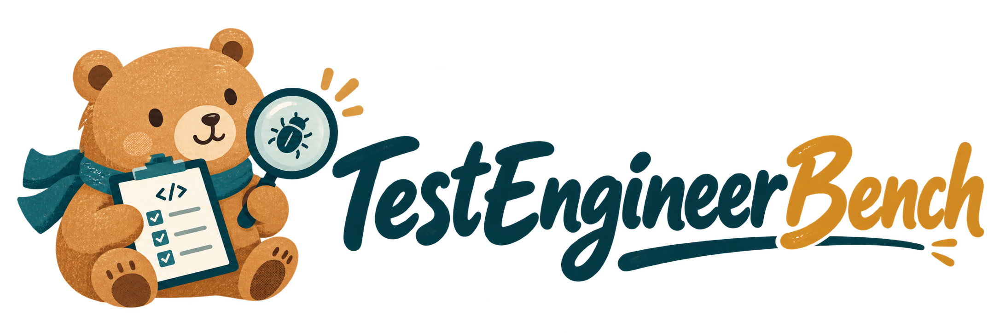

<p align="center"></p>

<p align="center"><b>Evaluating Coding Agents as Autonomous Software Test Engineers</b></p>
<p align="center"><a href="assets/paper.pdf">Paper</a> · Code & data: coming soon</p>

TestEngineerBench evaluates requirements-driven testing and defect discovery across **100 instances**, **78 Python repositories**, **16 application categories**, and **531 recorded defect occurrences**. Agents receive a product requirements document, a prerelease repository, and a configured execution environment, without issue descriptions or investigation targets.

This repository contains the project website, not the benchmark implementation. It introduces the benchmark goal, requirements-driven investigation, two independent tasks and the original Figure 1, followed by sortable model results, interactive dataset statistics, five RQ groups with concise takeaways and evidence charts, a complete Folium task input with output excerpts, and six trajectory case studies.

### Local preview

Requires Node.js 18 or newer. No packages or build step are required.

```sh
npm run dev
# http://localhost:4173
npm run check
```

### Hosting

All site resources use relative paths, supporting both root domains and GitHub Pages project paths. The included GitHub Actions workflow skips private repositories and deploys a curated static artifact on pushes to `main` or manual dispatch. Enable **Settings → Pages → Source → GitHub Actions** first. A private repository requires a GitHub plan that supports Pages for private repositories; this project does not change repository visibility.

Published project URL: `https://tokenwave-ai.github.io/TestEngineerBench-Page/`.

### Visual system

The site follows the supplied TokenWave research guidelines: white/black/gray surfaces, blue links, limited lime emphasis, 1120px content width, 32/24/18px headings and 14px body text. The public site self-hosts the OFL-licensed Noto Sans SC Latin webfont as the guideline’s compatibility font. Actual Franie Test Regular/SemiBold files are available only for local unpublished previews under ignored `.local-assets/franie/`; the development server injects them locally. The foundry limits Test fonts to unpublished work, so they are not committed or included in Pages. Use `?font=compatible` locally to check the public typography. Franie remains first in the font stack for viewers who have it installed. Body text is 14/22px and captions 12/18px; section/card headings follow 32/24/18px levels. The approved bear artwork is preserved. `assets/tokenwave.svg` is the unmodified horizontal black-wordmark brand asset, used in affiliations and the footer.

### Content and assets

- `index.html`, `style.css`, `script.js`: page, responsive styling, model tables, linked category/repository filters, distribution charts, findings and case tabs, citation copying.
- `assets/paper-content.js`: manuscript excerpts, complete PRD, instruction templates, six trajectory cases, and the 78-repository inventory.
- `assets/figure1.svg`: the paper’s original Figure 1, copied from its self-contained source SVG.
- `assets/folium-prd.md`: the complete Folium episode-0001 PRD, as reproduced in Appendix C.
- `assets/wordmark-option-a.svg`: selected blue/black lettering with a blue underline.
- `assets/paper.pdf`: user-supplied paper dated October 25, 2026.
- `assets/logo.svg` / `assets/logo.png`: transparent horizontal logo for a README or website.
- `assets/logo-display.png`: the full logo with transparent outer margins removed.
- `assets/wordmark.png`: original lettering extracted from the approved logo.
- `assets/wordmark-brand.svg`: self-contained black/brand-blue title variant, preserving the original lettering silhouette.
- `assets/mascot.svg` / `assets/mascot.png`: standalone bear extracted from the approved logo.
- `assets/tokenwave-favicon.svg` / `assets/favicon.png`: the official blue TokenWave symbol for browser tabs, with a 64px PNG fallback.
- `assets/hero.svg`: original workbench illustration.
- `assets/social.png`: 1200 × 630 social preview.

The approved bear logo was supplied by the project author. `assets/logo.png` preserves the original transparent PNG exactly. The mascot is extracted from that artwork without redrawing, and the workbench and social preview reuse the same character. The `.svg` logo and mascot files are self-contained wrappers embedding the PNG artwork; they are not vector redraws. The logo can be reused in the benchmark repository with:

```md
<p align="center"></p>
```

Copy `assets/logo.png` to the destination repository first.

### Results and provenance

All model numbers are transcribed from Tables 3 and 5 of the supplied PDF, not live leaderboard measurements. The abstract, full PRD, code, narration and case analysis come from the matching manuscript (`TestEngineerBench-Paper/main.tex`). Key Findings now condenses each RQ into three source-backed points and two chart views, rather than reproducing every analysis paragraph. The original RQ excerpts remain in `assets/paper-content.js` for provenance. Chart values come from Tables 3, 5, 6 and 7 and the reported RQ4 mechanism shares; no budget experiments or model results are synthesized. The six focused cases preserve the paper’s archived-evaluation labels where applicable.

Appendix C supplies the complete Folium episode-0001 PRD, both task instruction templates, six Task 1 test excerpts and the Task 2 report excerpt. Outputs are excerpts exactly as qualified in the paper; the PRD is complete. Task 1 and Task 2 are independent runs. The Task 2 panel distinguishes 15 agent-reported findings from the five reference bugs credited by the evaluator. Appendix D supplies all six focused trajectory cases, including the original analysis.

Dataset charts use Figure 2, Table 2 and the current repository inventory: 78 repositories, 100 instances, 531 recorded defect occurrences and 16 application categories. Hovering or focusing a category expands its donut segment and updates the center count, legend, repository chart and inventory. The last preview stays active within the statistics section and resets on exit; touch users can tap. Chart nodes stay mounted to avoid focus frames and hover flicker. Colors come from the supplied chart palette and stay consistent in repository bars. Repository bars can switch between recorded defects, source kLOC and instances. The defects-per-instance histogram shows the paper’s exact counts without a grouping selector; it remains benchmark-wide because the paper does not publish category-by-defect joint counts. Source kLOC is a per-repository median for repository bars, while the 80.4k headline is the per-instance median from Table 2. Older release-audit files are not used.

Update `models` and `tracks` in `script.js` for leaderboard revisions and `assets/paper-content.js` for manuscript revisions, keeping the static abstract and caption in `index.html` synchronized. Code/data resources remain coming soon until official destinations exist.

The initial editorial layout drew on [Cambrian-S](https://cambrian-mllm.github.io/cambrian-s/); typography, UI and colors now follow the supplied TokenWave research guidelines. Benchmark-first organization also draws on [SWE-sweep](https://swesweep.com/). The bear follows the character in the paper’s Figure 1. The final logo was supplied and approved by the project author, with Active-SWE serving as a finish and lettering reference.

The Hugging Face button icon is sourced from [Simple Icons](https://github.com/simple-icons/simple-icons/blob/develop/icons/huggingface.svg) (CC0); GitHub and Hugging Face names and marks belong to their respective owners.

Content organization draws on [SWE-CoWork](https://tokenwave-ai.github.io/swe-cowork-page/) and [OSWorld-Science](https://discoailab.github.io/osworld-science-page/). The page follows statistics → film → benchmark purpose and investigation challenges → Figure 1 → independent tasks → result summary and Leaderboard → dataset charts → Key findings → Case studies. The full abstract is available in a collapsed disclosure near the citation. Benchmark descriptions and result interpretations are grounded in the paper. Leaderboard values are centered, column maxima use compact badges, and the position column follows the active metric sort without introducing a composite score.

Font sources: [Noto Sans SC / Google Fonts](https://fonts.google.com/noto/specimen/Noto+Sans+SC), with its OFL in `assets/fonts/OFL-NotoSansSC.txt`; [Franie Test terms](https://www.thatthattype.com/test-fonts). Local trial fonts were downloaded from the Franie package on Befonts and remain excluded from publication.

### Promotional film

`video/TestEngineerBench-promo.mp4` is a 45-second English film (1920×1080, 24 fps, H.264/AAC), with an original synthesized score and interface cues. `video/promo-poster.png` is its cover. The warm background, typing sequence, centered interface and concise result transitions take visual cues from the supplied BackSearch reference; none of its footage or audio is reused.

The Folium walkthrough uses the submitted option-forwarding assertion and evaluator outcomes from Appendix C (episode-0001, GPT-6-Astra). The repaired snapshot is an evaluator replay, not an agent-authored fix. The metrics are the paper’s seven-agent means, and the inventory counts match the current benchmark. The film uses OFL-licensed Noto Sans SC; no trial fonts are embedded. Static video font instances are derived from the same Noto webfont; the OFL is retained under `assets/fonts/`.

To edit or regenerate it, use Node.js 22+ and FFmpeg:

```sh
npm --prefix video ci
npm --prefix video run render
```

`video/render.mjs` controls timing, typography, diagrams and animation. `video/soundtrack.mjs` creates the original music and UI cues. The homepage embeds the film immediately before the benchmark introduction with native controls, a poster and no autoplay. The Pages workflow publishes only the MP4 and poster from `video/`; the film is not posted to social media.

Interactive presentation: tab indicators slide between selected buttons, panel changes fade in, and evidence/repository bars animate from zero. Animations respect reduced-motion preferences. RQ chart switches cover quality/localization, aggregate/per-model bug localization, function/hunk recall by defect type, test/localization mechanisms, and paired recall/precision. Mechanism shares are independent reported percentages, not a normalized partition.
